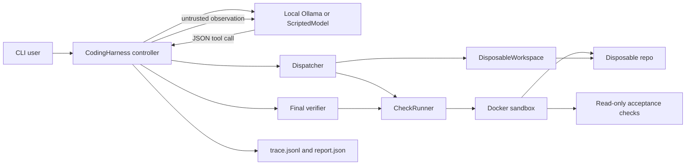
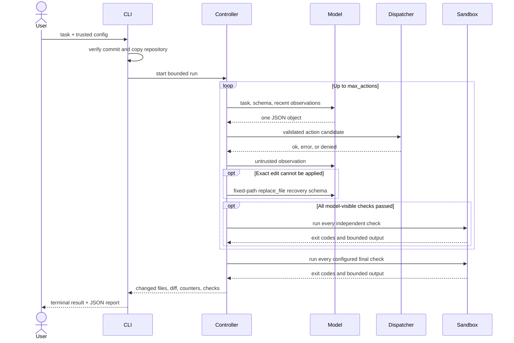

# Architecture

## Components

`CodingHarness` owns the bounded loop. `Dispatcher` validates exact action and
argument shapes before calling a tool. `DisposableWorkspace` owns path and
writable-scope checks. `CheckRunner` accepts only trusted commands from TOML;
the model selects a check name rather than submitting shell text.

## One run

## Trust boundaries

Trusted inputs are the harness source, TOML configuration, external acceptance
directory, and the human-selected source commit. Model replies, repository
content, and command output are untrusted. The controller never converts text
from an untrusted source into new permissions or an executable command.

The dispatcher enforces recovery phases independently of JSON Schema. After an
exact edit failure, only a complete replacement of the same writable file is
authorized. When all model-visible checks pass after the latest mutation, the
controller immediately runs the full verification set and can finish without
spending another model turn on a summary.

Docker is the intended execution boundary. The process backend retains timeout,
resource, process-group, and output controls but is only a compatibility mode
for reviewed local repositories.

