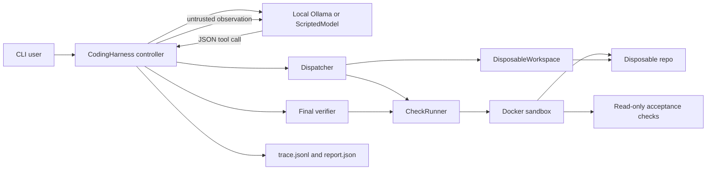
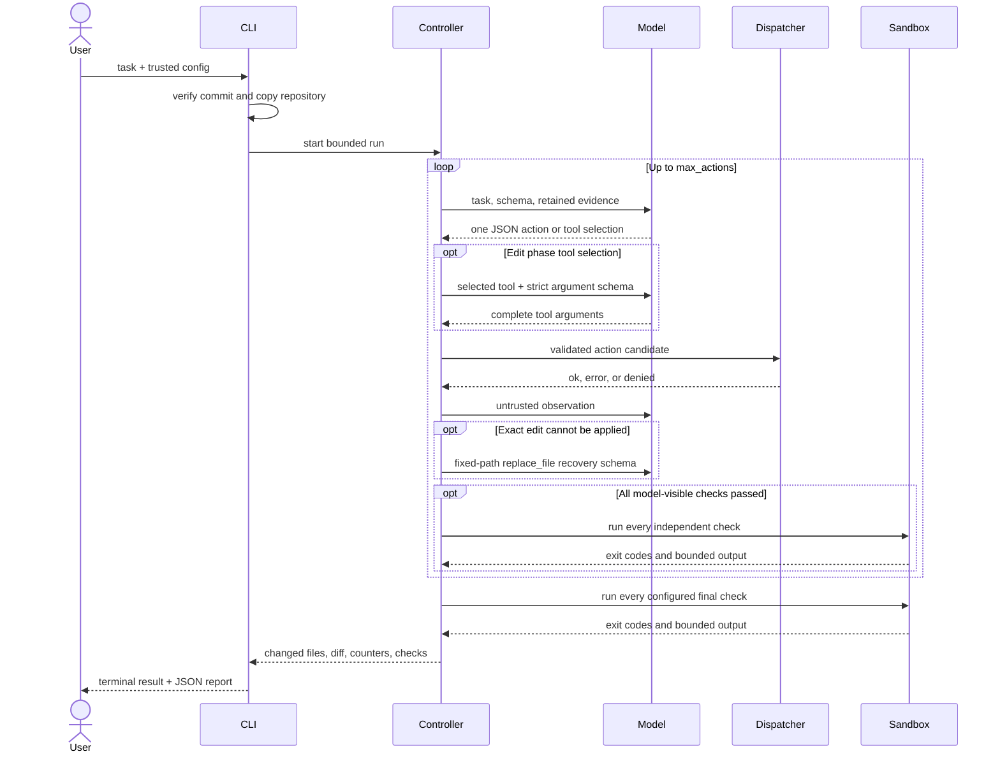

# Architecture

## Components

`CodingHarness` owns the bounded loop. `Dispatcher` validates exact action and
argument shapes before calling a tool. After the edit-mode inspection budget is
used, the controller first asks the model to select one tool and a short intent,
then asks for that tool's complete arguments under its strict schema. These two
model calls produce one harness action. Selector variants list the paths each
tool can use; an explicit path that maps to only one authorized tool can correct
an incompatible tool name, with the alignment recorded in the trace. A single
explicit path also narrows the second-stage argument schema to that file.
`DisposableWorkspace` owns path and
writable-scope checks. `CheckRunner` accepts only trusted commands from TOML;
the model selects a check name rather than submitting shell text.

In `read-only` mode, the controller supplies a schema containing only
`list_files`, `read_file`, `search_files`, and the final response. The
dispatcher independently enforces that allowlist, and final verification checks
that the disposable repository has no changed files without running coding
checks.

## One run

## Trust boundaries

Trusted inputs are the harness source, TOML configuration, external acceptance
directory, and the human-selected source commit. Model replies, repository
content, and command output are untrusted. The controller never converts text
from an untrusted source into new permissions or an executable command.

The dispatcher enforces recovery phases independently of JSON Schema. After an
exact edit failure, only a complete replacement of the same writable file is
authorized. The recovery context retains the failed edit, and the dispatcher
rejects a large copied block from another retained file before it can mix two
files. The controller removes each generated full-file recovery response from
conversation history after dispatch, so rejected retries cannot grow the next
prompt; the trace still retains the complete action for audit. When all
model-visible checks pass after the latest mutation, the
controller immediately runs the full verification set and can finish without
spending another model turn on a summary.

The model receives bounded observations. Repository file content is retained
once as current evidence, and failed check output is shortened while preserving
its beginning and end. One unresolved check failure remains visible through
edit recovery. A successful mutation automatically refreshes that same
configured check, updating or clearing the failure without another model turn;
when no check is unresolved, the first configured model-visible lint check runs
as a post-mutation guard. Assertion failures direct repairs toward implementation
code, while test edits remain available for test-code errors and requested new
coverage. The full tool arguments and check output remain in the trace and final
report, so prompt compaction does not remove audit evidence.

Docker is the intended execution boundary. The process backend retains timeout,
resource, process-group, and output controls but is only a compatibility mode
for reviewed local repositories.

